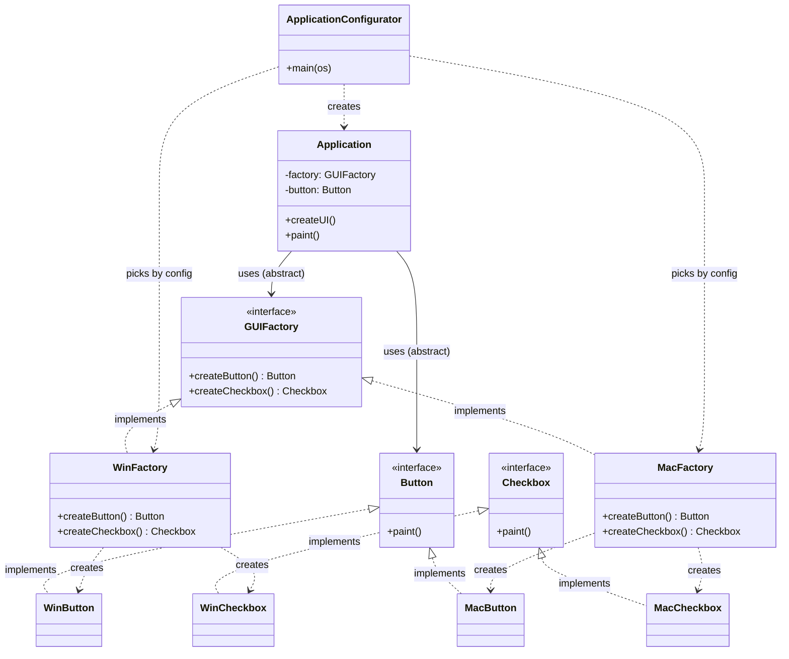
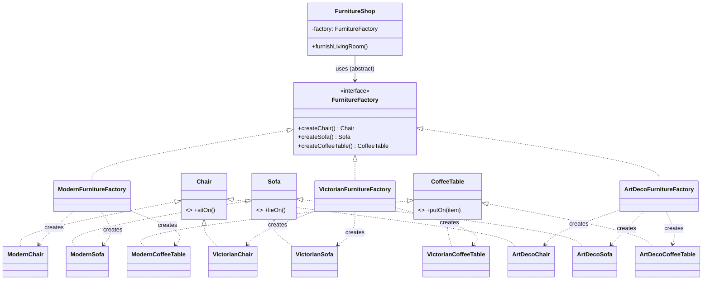

# Abstract Factory

**Intent:** a creational design pattern that lets you produce **families of related objects** without specifying their concrete classes.

## Files

| File | Scenario | Matches the explanation |
|------|----------|-------------------------|
| `Example1GuiFactory.java` | Cross-platform UI (Windows / macOS) | The **Pseudocode** section (`GUIFactory`, `WinFactory`, `MacFactory`, `Button`, `Checkbox`, `Application`, `ApplicationConfigurator`) |
| `Example2FurnitureFactory.java` | Furniture shop (Modern / Victorian / ArtDeco) | The **Problem / Solution** sections (`Chair`, `Sofa`, `CoffeeTable`, `ModernFurnitureFactory`, ...) |

Run (JDK 11 or newer):

```bash
java Example1GuiFactory.java
java Example2FurnitureFactory.java
```

Or compile first:

```bash
javac *.java
java Example1GuiFactory
java Example2FurnitureFactory
```

In each file the class that contains `main` is written first (required by the `java File.java` launcher); the pattern classes follow it.

## Relationships between classes and interfaces

### Example 1 - GUI factory



### Example 2 - Furniture factory



### How to read the diagrams

- **`<|..` (realization / implements):** every concrete class implements its interface. All `Chair` variants implement `Chair`; all factories implement the abstract factory interface.
- **`..>` (dependency / creates):** a concrete factory instantiates concrete products, **but its method signatures return the abstract product types**. This is why the client is never coupled to a variant.
- **`-->` (association / uses):** the client (`Application`, `FurnitureShop`) holds references **only to abstract types** (`GUIFactory`, `Button`, `Chair`, ...). It never mentions `WinButton`, `ModernSofa`, etc.
- **One factory = one variant:** `ModernFurnitureFactory` can only produce `Modern*` products, so a Modern sofa can never end up next to a Victorian chair.

### Roles mapped to the explanation

| Role in the pattern | Example 1 | Example 2 |
|---|---|---|
| Abstract Products | `Button`, `Checkbox` | `Chair`, `Sofa`, `CoffeeTable` |
| Concrete Products | `WinButton`, `MacButton`, `WinCheckbox`, `MacCheckbox` | `Modern*`, `Victorian*`, `ArtDeco*` |
| Abstract Factory | `GUIFactory` | `FurnitureFactory` |
| Concrete Factories | `WinFactory`, `MacFactory` | `ModernFurnitureFactory`, `VictorianFurnitureFactory`, `ArtDecoFurnitureFactory` |
| Client | `Application` | `FurnitureShop` |
| Factory selection at start-up | `ApplicationConfigurator.main()` | `createFactory(style)` |

## Extending it (Open/Closed Principle)

To add a new variant (for example Linux, or a Gothic furniture style): add the new concrete products, add one new concrete factory, and add one branch to the selection code. The client code does not change.
