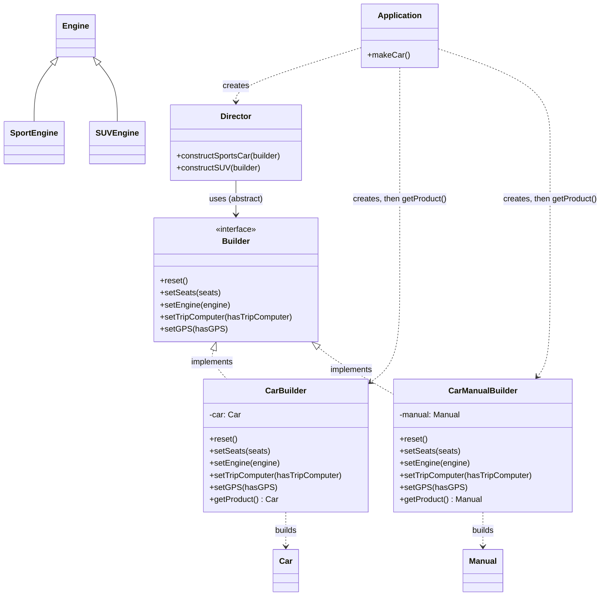
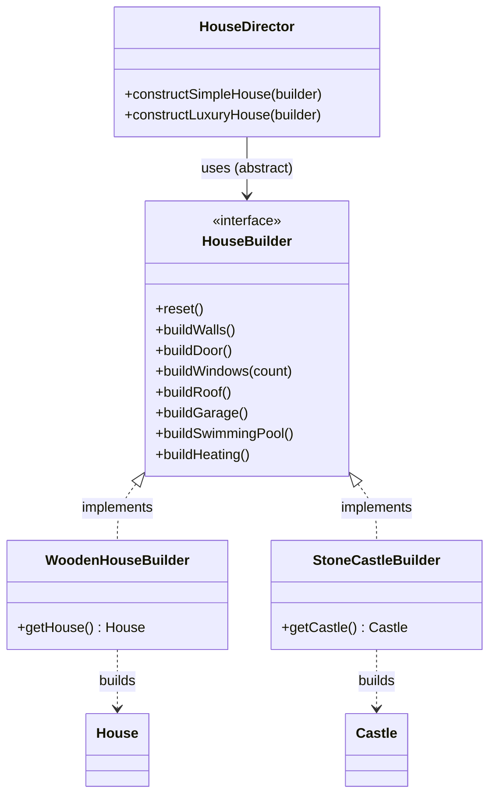

# Builder

**Intent:** a creational design pattern that lets you construct **complex objects step by step**. The same construction code can produce different types and representations of an object.

## Files

| File | Scenario | Matches the explanation |
|------|----------|-------------------------|
| `Example1CarBuilder.java` | Cars and car manuals | The **Pseudocode** section (`Builder`, `CarBuilder`, `CarManualBuilder`, `Car`, `Manual`, `Director`, `Application`) |
| `Example2HouseBuilder.java` | Houses and castles | The **Problem / Solution** sections (`buildWalls`, `buildDoor`, ..., wood house vs stone castle, simple vs luxury) |

Run (JDK 11 or newer):

```bash
java Example1CarBuilder.java
java Example2HouseBuilder.java
```

Or compile first:

```bash
javac *.java
java Example1CarBuilder
java Example2HouseBuilder
```

## Relationships between classes and interfaces

### Example 1 - Car and Manual



### Example 2 - House and Castle



### How to read the diagrams

- **`<|..` (implements):** every concrete builder implements the same builder interface, so the director can work with any of them.
- **`..>` (builds):** each concrete builder creates its own product. `House`/`Castle` and `Car`/`Manual` have **no common interface**. That is why the method that returns the result (`getProduct`, `getHouse`, `getCastle`) is declared in the **concrete builder** and not in the interface.
- **`-->` (uses):** the `Director` knows only the `Builder` interface. It defines the **order** of the steps and never mentions a concrete product.
- **Client:** creates the builder, hands it to the director, starts the construction, then takes the result **from the builder**.
- **Reset:** after `getProduct()` the builder resets itself, so the same builder object can produce another product.

### Roles mapped to the explanation

| Role in the pattern | Example 1 | Example 2 |
|---|---|---|
| Builder interface | `Builder` | `HouseBuilder` |
| Concrete Builders | `CarBuilder`, `CarManualBuilder` | `WoodenHouseBuilder`, `StoneCastleBuilder` |
| Products | `Car`, `Manual` | `House`, `Castle` |
| Director | `Director` | `HouseDirector` |
| Client | `Application` | `main()` |

## Why not a giant constructor?

Without Builder you would need either a subclass for every combination of options, or a "telescoping constructor" with many parameters that are mostly unused. With Builder you call **only the steps you need** (see the "no director" shed at the end of Example 2: only walls and roof).
