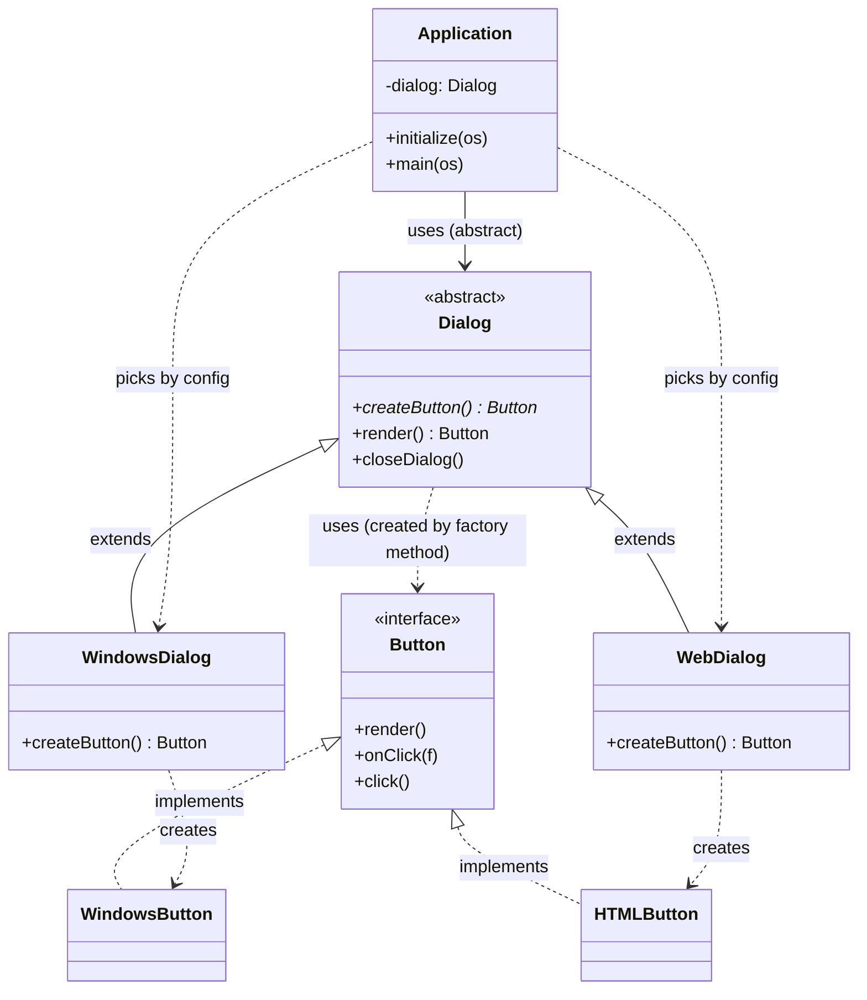
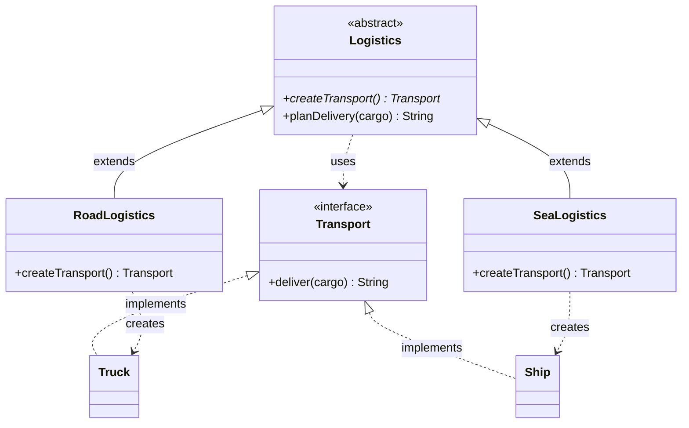

# Factory Method

**Also known as:** Virtual Constructor

**Intent:** a creational design pattern that provides an interface for creating objects in a superclass, but allows **subclasses to alter the type of objects** that will be created.

## Files

| File | Scenario | Matches the explanation |
|------|----------|-------------------------|
| `Example1Dialog.java` | Cross-platform dialog (Windows / Web) | The **Pseudocode** section (`Dialog`, `WindowsDialog`, `WebDialog`, `Button`, `WindowsButton`, `HTMLButton`, `Application`) |
| `Example2Logistics.java` | Logistics app (Truck / Ship) | The **Problem / Solution** sections (`Transport`, `Truck`, `Ship`, `RoadLogistics`, `SeaLogistics`) |

Run (JDK 11 or newer):

```bash
java Example1Dialog.java
java Example2Logistics.java
```

Or compile first:

```bash
javac *.java
java Example1Dialog
java Example2Logistics
```

## Relationships between classes and interfaces

### Example 1 - Dialog



### Example 2 - Logistics



`*` marks an abstract method.

### How to read the diagrams

- **`<|--` (inheritance):** concrete creators extend the creator class and **override the factory method** (`createButton`, `createTransport`).
- **`<|..` (implements):** all concrete products implement the same product interface. This is the condition that makes the pattern work: the factory method's return type is the **interface**, so subclasses can return different products.
- **`..>` creates:** only the concrete creator knows which concrete product it instantiates.
- **`Dialog ..> Button` / `Logistics ..> Transport`:** the creator's real job is **business logic** (`render`, `planDelivery`). It calls the factory method and uses the result through the interface, never knowing the concrete class.
- **Client:** works with the creator through its base type, so any creator subclass can be passed in.

### Roles mapped to the explanation

| Role in the pattern | Example 1 | Example 2 |
|---|---|---|
| Product (interface) | `Button` | `Transport` |
| Concrete Products | `WindowsButton`, `HTMLButton` | `Truck`, `Ship` |
| Creator (declares the factory method) | `Dialog.createButton()` | `Logistics.createTransport()` |
| Concrete Creators | `WindowsDialog`, `WebDialog` | `RoadLogistics`, `SeaLogistics` |
| Client | `Application` | `clientCode()` |

## Factory Method vs Abstract Factory

Factory Method has **one** creation method that **subclasses override** (inheritance). Abstract Factory has **a family** of creation methods grouped in an interface (composition: the client receives a factory object). The more factory methods you add to `Dialog`, the closer it gets to an Abstract Factory.
