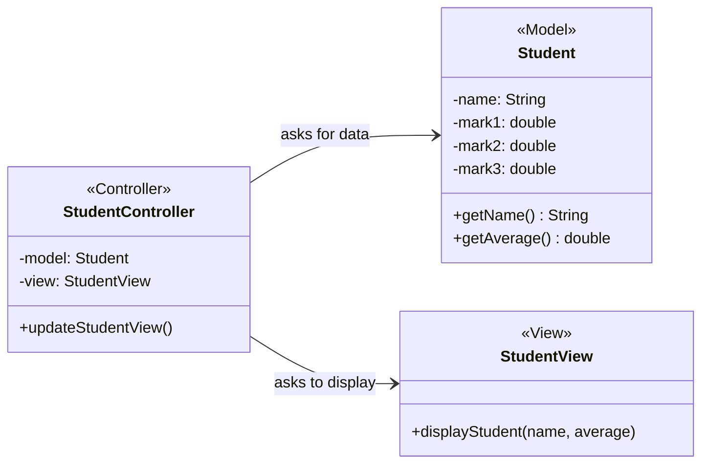
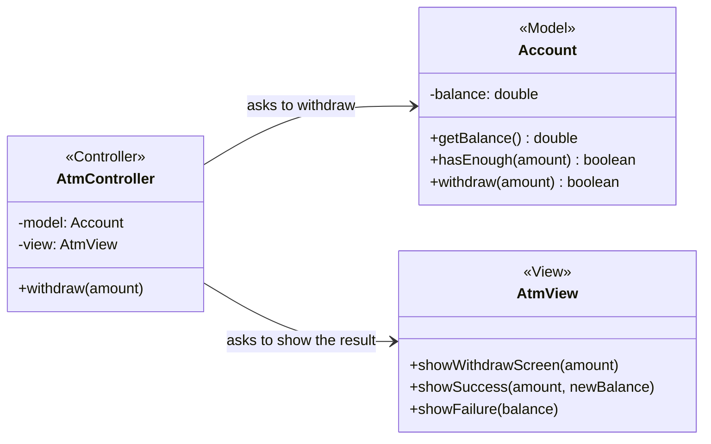
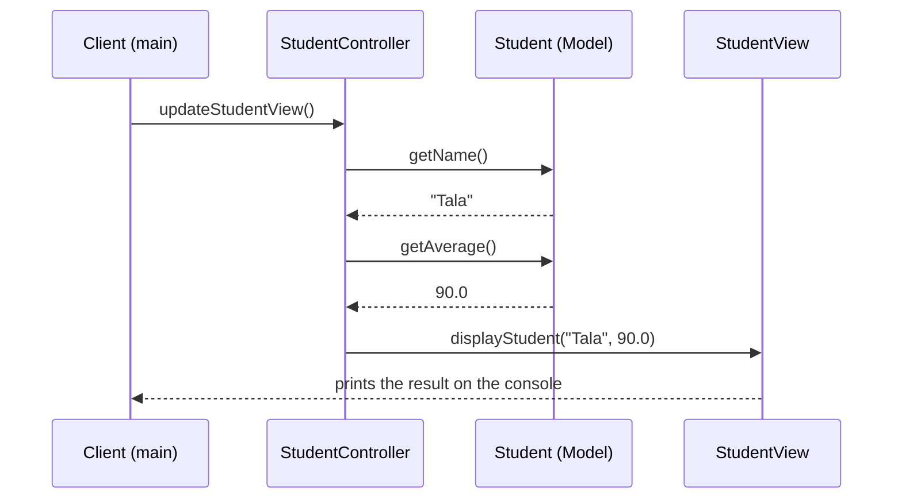

# MVC (Model - View - Controller)

**Intent:** an **architectural pattern** (not a creational or behavioral design pattern) that separates an application into three parts:

- **Model:** the data and the business logic.
- **View:** displaying information to the user.
- **Controller:** handling the user's request and coordinating between Model and View.

## Files

| File | Scenario | Matches the explanation |
|------|----------|-------------------------|
| `Example1StudentMvc.java` | Student marks and average | Sections 3 and 4 (`Student`, `StudentView`, `StudentController`, and the `Main` code) |
| `Example2AtmMvc.java` | ATM withdrawal | Section 5 (the 100 dinars example: balance 500, then insufficient balance) |

Run (JDK 11 or newer):

```bash
java Example1StudentMvc.java
java Example2AtmMvc.java
```

Or compile first:

```bash
javac *.java
java Example1StudentMvc
java Example2AtmMvc
```

In the explanation each class has its own file (`Student.java`, `StudentView.java`, ...). Here they are grouped in one file per example so that one command runs it. In a real project, put each class in its own file.

## Relationships between classes

### Example 1 - Student



### Example 2 - ATM



### How the data moves (Example 1)



### How to read the diagrams

- **The Model knows nobody:** `Student` and `Account` have no reference to the View or the Controller. They only keep data and rules (the average, the balance check).
- **The View knows nobody either:** `StudentView` and `AtmView` only display what they receive. They never calculate the average or check the balance.
- **The Controller knows both:** it is the only class that holds references to the Model and the View. It asks the Model for data or to do an operation, then asks the View to display the result.
- **Flow (simplified):** User -> View -> Controller -> Model -> Controller -> View. In real frameworks the details of the flow can differ.

### Roles mapped to the explanation

| Role | Example 1 | Example 2 | Responsibility | Not its job |
|---|---|---|---|---|
| Model | `Student` | `Account` | Data and business logic | Display |
| View | `StudentView` | `AtmView` | Display information | Calculations |
| Controller | `StudentController` | `AtmController` | Receive requests and coordinate | Storing data or displaying by itself |

## Discussion question

If you must add a new way to display the student data (for example a GUI instead of the console), you change the **View**. The Model (data and average) stays the same.
