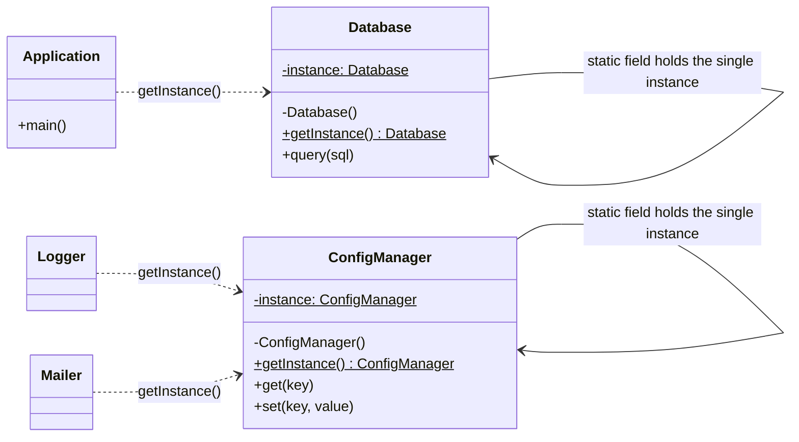

# Singleton

**Intent:** a creational design pattern that ensures a class has **only one instance**, while providing a **global access point** to it.

## Files

| File | Scenario | Matches the explanation |
|------|----------|-------------------------|
| `Example1Database.java` | Database connection | The **Pseudocode** section (`Database`, private constructor, `getInstance`, double-checked locking, `query`, `Application`) |
| `Example2ConfigManager.java` | Shared application configuration | The **Problem / Solution** sections: one shared instance, lazy initialization, safe in a multithreaded environment (20 threads race, one instance is created) |

Run (JDK 11 or newer):

```bash
java Example1Database.java
java Example2ConfigManager.java
```

Or compile first:

```bash
javac *.java
java Example1Database
java Example2ConfigManager
```

## Relationships between classes



`$` marks a **static** member and `-` a **private** member.

### How to read the diagram

- **Self-association:** the Singleton class holds a reference to **its own type** in a private static field. That field is the cache of the one and only instance.
- **Private constructor:** clients cannot write `new Database()`; the compiler rejects it outside the class (see the commented line at the end of `Example1Database.java`).
- **`getInstance()`:** the only way in. On the first call it creates the object (lazy initialization); on every later call it returns the cached one.
- **Clients depend on the class, not on a created object:** `Application`, `Logger` and `Mailer` all call `getInstance()` and receive the **same** object, so `foo == bar` is `true`.
- **Thread safety:** the check `instance == null` is repeated inside the `synchronized` block (double-checked locking), and the field is `volatile`, so two threads cannot both create the object.

### Roles mapped to the explanation

| Step from "Solution" | Where it is in the code |
|---|---|
| Make the default constructor private | `private Database()` |
| Static creation method that calls the private constructor and caches the result | `getInstance()` |
| Static field storing the instance | `private static volatile Database instance` |
| Lazy initialization | created on the first `getInstance()` call |
| Multithreading care | `synchronized (Database.class)` + second `null` check |

`ConfigManager` also has `resetForDemo()` and `getCreationCount()`. They exist only so the demo can repeat the thread race and prove the constructor ran once. A real Singleton would not expose them.

## Caveats (from "Pros and Cons")

It violates the Single Responsibility Principle (it solves two problems), it can hide bad design, and it is harder to unit test because the constructor is private and static methods are hard to mock.
