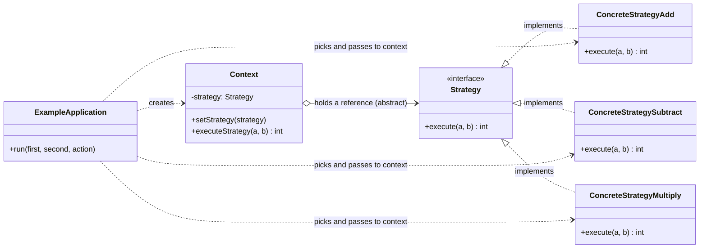
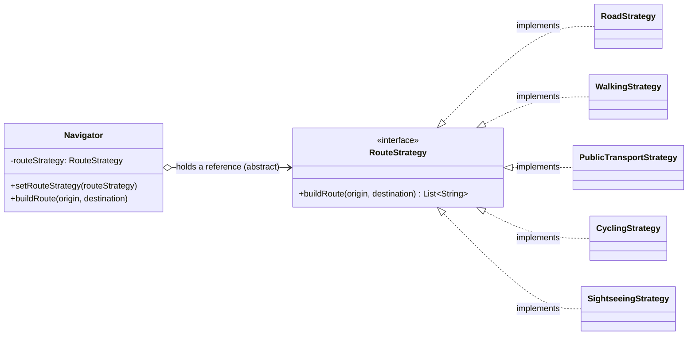

# Strategy

**Intent:** a behavioral design pattern that lets you define a **family of algorithms**, put each of them into a separate class, and make their objects **interchangeable**.

## Files

| File | Scenario | Matches the explanation |
|------|----------|-------------------------|
| `Example1Calculator.java` | Add / subtract / multiply | The **Pseudocode** section (`Strategy`, `ConcreteStrategyAdd`, `ConcreteStrategySubtract`, `ConcreteStrategyMultiply`, `Context`, `ExampleApplication`) |
| `Example2Navigator.java` | Navigation app: road, walking, public transport, cycling, sightseeing | The **Problem / Solution** sections (`buildRoute`, the navigator as context, switching the strategy at runtime) |

Run (JDK 11 or newer):

```bash
java Example1Calculator.java
java Example2Navigator.java
```

`Example1Calculator.java` also accepts your own input:

```bash
java Example1Calculator.java 12 4 multiplication
```

Or compile first:

```bash
javac *.java
java Example1Calculator
java Example2Navigator
```

## Relationships between classes and interfaces

### Example 1 - Calculator



### Example 2 - Navigator



### How to read the diagrams

- **`<|..` (implements):** every algorithm is a class that implements the same strategy interface. That is what makes the strategies **interchangeable**.
- **`o-->` (aggregation):** the context **holds a reference** to a strategy and works with it **only through the interface**. It doesn't know which concrete class it has, and it doesn't choose it.
- **The client chooses:** the client creates a concrete strategy and gives it to the context with the setter (`setStrategy`, `setRouteStrategy`). It must know the differences between strategies to choose properly.
- **Runtime switching:** calling the setter again changes the behavior while the program runs. The context code is never modified (Open/Closed Principle).
- **Composition instead of inheritance:** the behavior comes from an object the context **has**, not from subclasses of the context.

### Roles mapped to the explanation

| Role in the pattern | Example 1 | Example 2 |
|---|---|---|
| Strategy interface | `Strategy` | `RouteStrategy` |
| Concrete Strategies | `ConcreteStrategyAdd`, `ConcreteStrategySubtract`, `ConcreteStrategyMultiply` | `RoadStrategy`, `WalkingStrategy`, `PublicTransportStrategy`, `CyclingStrategy`, `SightseeingStrategy` |
| Context | `Context` | `Navigator` |
| Client | `ExampleApplication` | `main()` (plays the role of the UI buttons) |

## Lambda note

The explanation says modern languages can use anonymous functions instead of extra classes. `Example2Navigator.java` shows that: since `RouteStrategy` has a single method, `navigator.setRouteStrategy((from, to) -> ...)` works without a new class.
